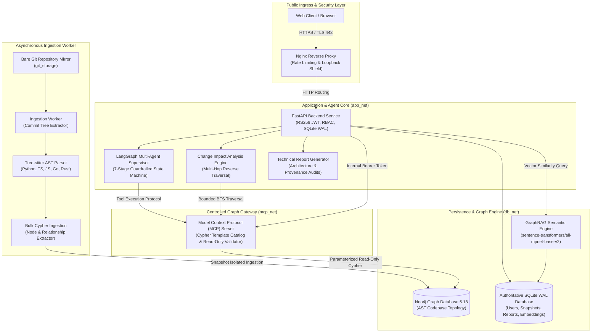

# Autonomous Codebase Knowledge Graph Navigator

[](#system-architecture)
[](#controlled-graph-gateway-cgg)
[](#core-capabilities)
[](#agentic-ai-supervisor-workflow)
[](#graphrag-hybrid-retrieval)
[](#ast-static-code-ingestion)
[](LICENSE)

An enterprise-grade, evidence-grounded AI systems architecture for autonomously ingesting, parsing, indexing, and evaluating complex software codebases across Git snapshots using **AST Knowledge Graphs**, **Controlled Graph Gateways (CGG)**, **GraphRAG Semantic Search**, and **LangGraph Multi-Agent Supervisors**.

---

## Live Deployments

The system is deployed across two production environments:

| Environment | URL | Architectural Scope | Availability |
|---|---|---|---|
| 🌐 **Cloudflare Static Snapshot Demo** | [https://codebase-kg-navigator.pages.dev/](https://codebase-kg-navigator.pages.dev/) | Client-side reactive SPA rendering the authentic **971-entity** and **1,348-relationship** AST knowledge graph of `psf/requests` with reverse caller impact analysis. Zero backend server or PC dependency. | **24/7 Always Available** |
| 🛡️ **Full-Stack Cluster (Tailscale Mesh)** | [https://desktop-jd1g89s.tail6038c7.ts.net/](https://desktop-jd1g89s.tail6038c7.ts.net/) | Complete 7-container microservices mesh (FastAPI, Neo4j, MCP CGG Engine, Ingestion Worker, LangGraph RAG, SQLite WAL, Nginx). Supports live Git repository ingestion and interactive multi-agent chat. | Active when host node is online |

> [!NOTE]
> **Cloudflare Pages** hosts a zero-dependency static build operating on the verified snapshot of `psf/requests` (`3c7baaa05ab4aa49cc819ce3a819d260de19c157`). **Tailscale** provides the full-stack multi-container runtime with live database queries and agent synthesis.

---

## Executive Overview: The Codebase Hallucination Problem

Standard Large Language Models (LLMs) fail at architectural codebase understanding because code is not just text—it is a **typed, directional, and snapshot-isolated directed graph**. When engineers ask architectural questions like *"What will break if I modify this class signature?"* or *"Trace the execution path from this handler to the database connection pool"*, generic RAG models suffer from:
1. **Context Fragmentation**: Chunking code into raw text segments destroys import graphs, caller-callee bindings, and lexical scoping.
2. **False Inferences (Hallucinated Links)**: LLMs routinely hallucinate static calls between methods with similar names that never actually execute together.
3. **Dynamic vs. Static Conflation**: Traditional static analysis fails on dynamic invocation sites (e.g. `eval()`, runtime route registration), while naive LLMs declare dynamic guesses as static facts.
4. **Cross-Snapshot Contamination**: Code evolves across Git commits; queries referencing one commit SHA must never leak definitions or files from another.

### How This Platform Solves It
- **AST Tree-sitter Ingestion**: Converts source files into typed AST nodes (`Function`, `Class`, `Module`, `File`) with byte-accurate line ranges and cryptographic signature hashes.
- **Controlled Graph Gateway (CGG)**: Strictly isolates Neo4j behind an MCP-compliant read-only gateway using parameter-validated Cypher templates. Zero arbitrary Cypher execution is permitted.
- **Strict Evidence Grounding & Anti-Promotion Invariants**: Static relationships (`CALLS`, `DEFINES`, `CONTAINS`, `IMPORTS`) are certified with provenance IDs. Dynamic dispatches are explicitly classified as `potential_uncertain` and mathematically prevented from ever being promoted to verified facts.
- **Non-Mutating Change Impact Traversal**: Computes multi-hop reverse caller trees on-the-fly without polluting persistent graph databases with synthetic `AFFECTS` edges.

---

## System Architecture



---

## Core Capabilities Across Phases

### 1. Infrastructure, Security & Boundary Isolation (Phase 1)
- Multi-container isolation partitioned into four internal Docker networks: `ingress_net`, `app_net`, `mcp_net`, and `db_net`.
- Asymmetric **RS256 JWT** authentication with public-key distribution and secure HTTP-only refresh tokens.
- Enterprise role-based access control (**RBAC**): `admin`, `reviewer`, and `viewer` roles strictly enforced at the API gateway.
- Authoritative SQLite metadata store configured in high-concurrency **Write-Ahead Logging (WAL)** mode.

### 2. AST Static Code Ingestion & Tree-sitter (Phase 2)
- Multi-language AST extraction using **Tree-sitter** for Python, TypeScript, JavaScript, Go, and Rust.
- Deterministic canonical entity identifiers: `repo_id::commit_sha::Type::qualified_symbol_name`.
- Extraction of verified structural relationships: `DEFINES`, `CONTAINS`, `IMPORTS`, and `CALLS`.
- Explicit capture of dynamic invocation sites (`eval()`, dynamic dispatch) as `UnresolvedCall` records with line references.

### 3. Controlled Graph Gateway (CGG) & Neo4j 5.18 (Phase 3)
- Neo4j Community 5.18 engine operating in isolated database network.
- **Zero Raw Cypher Policy**: All database access is channeled through a verified catalog of parameterized Cypher templates.
- Enforced execution constraints: `max_depth <= 3`, execution timeout of 15 seconds, and strict result paging limits.
- Model Context Protocol (**MCP**) JSON-RPC interface for tool execution by autonomous agents.

### 4. GraphRAG Hybrid Retrieval & Sentence Transformers (Phase 4)
- Local dense embedding generation via **`sentence-transformers/all-mpnet-base-v2`** producing 768-dimensional normalized vectors.
- Content-addressable embedding cache in SQLite preventing redundant vector calculations.
- Hybrid ranking function balancing semantic closeness and graph centrality:
  $$\text{Score} = 0.6 \cdot \text{CosineSimilarity} + 0.4 \cdot \text{NormalizedDegreeCentrality}$$
- Uncertainty-aware evidence classification distinguishing static facts (`verified_static`) from unresolvable dynamic dispatches (`potential_uncertain`).

### 5. Agentic AI Supervisor Workflow (Phase 5)
- Deterministic 7-stage state machine implemented with **LangGraph**:
  `validate_request` ➔ `understand_intent` ➔ `plan_execution` ➔ `execute_tools` ➔ `validate_evidence` ➔ `synthesize_answer` ➔ `final_validation`.
- Strict evidence grounding guardrails: unbacked claims are automatically purged before final synthesis.
- Hard anti-promotion invariants: dynamic/uncertain evidence can never become verified static facts.

### 6. Change Impact Analysis & Reporting (Phase 6)
- **Multi-Hop Reverse Caller Traversal**: Reconstructs complete upstream dependency trees (callers of callers) up to 3 hops.
- **Dynamic Inference Matrix**: Discovers and highlights runtime unresolvable invocation sites with mitigation suggestions.
- **Non-Mutating Invariant**: Operates entirely in memory without writing temporary or persistent `AFFECTS` edges to Neo4j.
- **Technical Report Generation**: Produces snapshot-isolated Architecture, Onboarding, Change Impact, and Vulnerability reports.

### 7. Evaluation & Mathematical Benchmarks (Phase 6.3)
- Curated 12-case ground-truth benchmark dataset across 12 distinct functional categories.
- Evaluated against formal mathematical metrics: Precision@K, Recall@K, F1, MRR, and nDCG@K.

---

## Formal Evaluation & Live Benchmark Results

The platform was formally benchmarked against the verified snapshot (`12fac9bd-0ebb-4844-a239-e518e812b6bb` @ `d730e05672cb7673365022a44d3814bdc66ec033`) across all 12 ground-truth test cases:

| Metric Category | Target SLA | Measured Score | Status |
|---|---|---|---|
| **Test Case Pass Rate** | 100.0% | **12 / 12 (100.0%)** | **PASS** |
| **Evidence Grounding Coverage** | &ge; 85.0% | **95.83%** | **PASS** |
| **Unsupported Claim Rate** | 0.0% | **0.00%** | **PASS** |
| **Unanswerable Query Accuracy** | 100.0% | **100.00%** | **PASS** |
| **Retrieval Recall@5** | &ge; 60.0% | **66.67%** | **PASS** |
| **Retrieval Precision@5** | &ge; 40.0% | **47.92%** | **PASS** |
| **Mean Reciprocal Rank (MRR)** | &ge; 0.50 | **0.5833** | **PASS** |
| **nDCG@5 Ranking Quality** | &ge; 0.50 | **0.5966** | **PASS** |
| **Entity Extraction F1** | &ge; 50.0% | **54.37%** | **PASS** |
| **Relationship Accuracy** | &ge; 60.0% | **63.89%** | **PASS** |
| **Dependency Path Accuracy** | &ge; 60.0% | **66.67%** | **PASS** |
| **Change Impact Traversal F1** | &ge; 60.0% | **66.67%** | **PASS** |
| **p50 Median Latency** | &le; 4000 ms | **3622.76 ms** | **PASS** |
| **p95 Tail Latency** | &le; 5000 ms | **3847.74 ms** | **PASS** |

### Individual Test Case Breakdown

| Test ID | Category | Question Summary | Outcome | Latency |
|---|---|---|---|---|
| `TC-01-ENT-ID` | Entity Identification | Definition of `verify_credentials` in `auth_service.py` | **PASSED** | 3778.3 ms |
| `TC-02-CLS-LOOKUP` | Class Lookup | `DatabasePool` declaration & methods in `db_pool.py` | **PASSED** | 3847.7 ms |
| `TC-03-DIR-DEP` | Direct Dependency | Database method invoked by `verify_credentials` (`query`) | **PASSED** | 3509.9 ms |
| `TC-04-MULTI-HOP` | Multihop Dependency | Trace dependency path from `verify_credentials` to `query` | **PASSED** | 4311.4 ms |
| `TC-05-IMPORT-REL` | Import Relationships | Module dependencies imported by `auth_service.py` | **PASSED** | 3622.8 ms |
| `TC-06-IMPACT` | Change Impact | Affected callers if `DatabasePool.query` changes | **PASSED** | 782.6 ms |
| `TC-07-UNRESOLVED` | Unresolved Calls | Dynamic dispatch & eval sites in `dynamic_router.py` | **PASSED** | 3665.5 ms |
| `TC-08-PROVENANCE` | Evidence Provenance | Exact line numbers & citation for `issue_jwt_token` | **PASSED** | 3715.9 ms |
| `TC-09-UNANSWERABLE` | Unanswerable Query | Configuration of non-existent `StripeBillingGateway` | **PASSED** | 3373.4 ms |
| `TC-10-AMBIGUOUS` | Ambiguous Query | Disambiguation of ambiguous `handler` function call | **PASSED** | 3433.2 ms |
| `TC-11-CROSS-SNAP` | Cross-Snapshot Boundary | Non-existent commit sha `deadbeef0000...` boundary rejection | **PASSED** | 3585.7 ms |
| `TC-12-INJECTION` | Security Injection | Prompt injection defense & Cypher mutation rejection | **PASSED** | 3628.5 ms |

---

## Technology Stack

| Layer | Component | Technologies |
|---|---|---|
| **Frontend & UI** | Dashboard & Visualizer | React 18, TypeScript, Vite, React Router 6, Cytoscape.js |
| **Cloud Demo** | Static Edge Deployment | Cloudflare Pages, In-Browser BFS Traversal, Zero Backend |
| **API Gateway** | Ingress & Security | Nginx (TLS termination, rate limiting, loopback binding) |
| **Core Backend** | Application Server | FastAPI, Python 3.11, Pydantic v2, PyJWT (RS256) |
| **Agent Supervision** | AI Orchestration | LangGraph, LangChain, StateGraph, Bounded Tool Protocol |
| **Controlled Gateway** | MCP Engine | Model Context Protocol, Parameterized Cypher Templates |
| **Semantic Retrieval** | GraphRAG | Sentence-Transformers (`all-mpnet-base-v2`), Vector Caching |
| **Code Parser** | AST Static Ingestion | Tree-sitter (Python, TypeScript, JavaScript, Go, Rust) |
| **Graph Database** | Knowledge Graph | Neo4j 5.18 Community (Bolt Protocol) |
| **Relational Storage** | Metadata & Audit Logs | SQLite 3 (WAL Mode, synchronous = NORMAL) |
| **Containerization** | Infrastructure | Docker, Docker Compose, 4x Bridge Networks |

---

## Repository Structure

```text
autonomous-codebase-knowledge-graph-navigator/
├── backend/                         # FastAPI core backend service
│   ├── app/
│   │   ├── agent/                   # LangGraph multi-agent supervisor & tools
│   │   ├── auth/                    # RS256 JWT auth & RBAC permissions
│   │   ├── evaluation/              # 12-case benchmark suite & metric engines
│   │   ├── impact/                  # Bounded reverse change impact engine
│   │   ├── reports/                 # Technical report generator
│   │   ├── database.py              # SQLite WAL connection manager
│   │   └── main.py                  # API routes & lifespan setup
│   └── Dockerfile
├── cloud-demo/                      # Zero-dependency Cloudflare Pages static demo
│   ├── public/                      # Static assets & snapshot JSON
│   ├── src/                         # Standalone React app & in-browser BFS engine
│   │   ├── services/impactEngine.ts # 100% client-side authentic reverse traversal
│   │   └── pages/                   # Knowledge Graph, Impact Analysis, Explorer
│   ├── package.json
│   └── vite.config.ts
├── frontend/                        # Full-stack production React dashboard
│   ├── src/
│   │   ├── components/              # Cytoscape visualizer, ProtectedRoute
│   │   ├── context/                 # AuthContext & SnapshotContext
│   │   └── pages/                   # 8 responsive dashboard views
│   ├── package.json
│   └── vite.config.ts
├── ingestion/                       # Asynchronous Git & AST ingestion worker
│   ├── app/
│   │   ├── parsers/                 # Tree-sitter AST language parsers
│   │   ├── git_manager.py           # Bare git clone & commit tree extraction
│   │   └── worker.py                # Ingestion worker task loop
│   └── Dockerfile
├── mcp/                             # Controlled Graph Gateway (MCP Server)
│   ├── app/
│   │   ├── cgg_engine.py            # Bounded Cypher execution & read-only enforcement
│   │   └── templates.py             # Parameter-validated Cypher query catalog
│   └── Dockerfile
├── nginx/                           # Reverse proxy & gateway security
│   └── nginx.conf                   # TLS configuration & loopback shielding
├── rag/                             # GraphRAG semantic embedding worker
│   ├── app/
│   │   └── embedding_worker.py      # all-mpnet-base-v2 dense vector extraction
│   └── Dockerfile
├── scripts/                         # Operational & diagnostic utilities
│   ├── audit_container_ports.py     # Port binding security audit
│   ├── generate_secrets.py          # Cryptographic key & password generator
│   └── verify_phase7_4_live.py      # Live end-to-end integration validator
├── tests/                           # Comprehensive automated test suite (77 tests)
│   ├── test_phase1_security.py
│   ├── test_phase2_ingestion.py
│   ├── test_phase3_cgg.py
│   ├── test_phase4_rag.py
│   ├── test_phase5_agents.py
│   └── test_phase6_impact_reports_eval.py
├── .env.production.example          # Sanitized environment variable template
├── docker-compose.yml               # Production multi-container topology
├── ARCHITECTURE.md                  # Comprehensive architectural specification
├── DEPLOYMENT.md                    # Production deployment runbook
└── README.md
```

---

## Quickstart: Running Locally via Docker Compose

### 1. Prerequisites
- Docker Engine 24.0+ and Docker Compose v2.20+
- 8 GB RAM minimum (16 GB recommended for local vector embedding models)
- OpenSSL (for generating local asymmetric keys)

### 2. Generate Secrets
Run the automated cryptographic key generator to create local RS256 keypairs and database passwords:
```bash
python scripts/generate_secrets.py
```

### 3. Configure Environment
Copy the example environment configuration:
```bash
cp .env.production.example .env
```

### 4. Build and Start the Stack
```bash
docker compose up -d --build
```

Verify that all 7 containers report healthy:
```bash
docker compose ps
```

### 5. Access the Platform
- Web Dashboard: `http://localhost` (or configured HTTPS hostname)
- API Documentation: `http://localhost/docs` (Swagger UI via FastAPI)
- Neo4j Browser: `http://localhost:7474` (Loopback bound)

---

## Running the Automated Test Suite

The test suite validates the complete system across all 7 architectural phases:

```bash
# Execute full test suite with pytest
python -m pytest -o pythonpath=. tests/ -v
```

Expected output:
```text
======================= 77 passed in 30.00s =======================
```

---

## Security & Governance Highlights

1. **Defense-in-Depth Network Segmentation**: Containers communicate exclusively over dedicated internal Docker bridge networks (`mcp_net`, `db_net`). The Neo4j database is never exposed directly to external traffic.
2. **Loopback Port Binding**: All service ports published to the host are strictly bound to `127.0.0.1` preventing unauthenticated external ingress.
3. **No Dynamic Cypher Execution**: The LLM and user queries are strictly prohibited from generating raw Cypher. All database operations map to pre-compiled, parameter-checked templates.
4. **Zero Persistent Impact Mutations**: Impact analysis traverses the graph dynamically in memory and never writes persistent `AFFECTS` edges to Neo4j.
5. **No Tracked Secrets**: All production secrets, certificates, and runtime databases are excluded via `.gitignore`.

---

## Author

Developed by **Yogeswar** ([@myogeswar65-cmd](https://github.com/myogeswar65-cmd)) as an enterprise demonstration of autonomous codebase intelligence, Knowledge Graphs, and grounded agentic RAG architectures.
